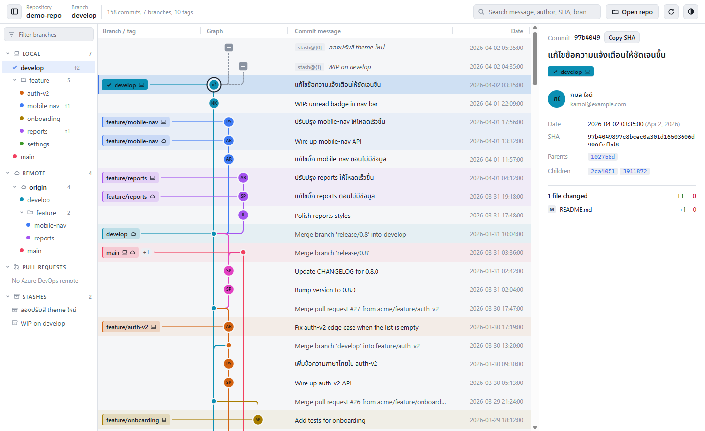

# GitKrapao

A GitKraken-style Git history viewer for the desktop. It reads repositories on your machine directly. Its focus is a commit, branch and merge graph that is easy to read and stays smooth even with hundreds of thousands of commits.

> This is a **read-only** version: it never changes anything in your repository. To commit, check out, merge, push or stage, use your editor or a terminal as usual.

Built with Tauri 2 (Rust) and TypeScript (strict) with plain HTML/CSS and no framework; esbuild bundles the UI into one file.

<picture>
  <source media="(prefers-color-scheme: dark)" srcset="docs/screenshots/graph-dark.png">
  
</picture>

## Features

- **History graph:** each branch gets its own lane and color, merges are drawn, and branches and tags are labeled. Pages load on demand and only the visible part is drawn, so large repositories stay smooth.
- **Auto-refresh:** checks every 3 seconds. After a commit, fetch, checkout or rebase, only what changed is loaded.
- **Left panel:**
  - every branch, split into LOCAL and REMOTE, grouped into folders by name, with ahead/behind counts
  - STASHES
  - PULL REQUESTS from Azure DevOps
- **Hide branches and Solo:** hide branches you don't care about, or show only a few. The choice is remembered per repository.
- **WIP row:** uncommitted files, staged and unstaged, at the top of the graph.
- **Stashes in the graph:** gray nodes above the commit each stash was made on.
- **Commit details:** full message, author, parents and children, and changed files with +/− counts.
- **Diff view:** unified or split, changes only or the full file, changed words highlighted, and syntax colors for about 20 languages.
- **Search:** by message, author, SHA or branch name.
- **Other:** light and dark themes, resizable columns, and correct Thai text rendering.

## Installing

1. Install **Git for Windows** so the `git` command works. Running `git --version` in a terminal should print a version.
2. Download `GitKrapao_x.y.z_x64-setup.exe` from the [latest release](https://github.com/korrawichT/GitKrapao/releases/latest), run it and click through to the end. It installs for the current user only, so it needs no admin rights; a newer installer updates the app in place and keeps your settings.
   - If Windows shows "Windows protected your PC", click **More info → Run anyway**. The installer is not code-signed yet.
3. Start the app, click **Open repo** and pick any folder inside a repository.

To see Azure DevOps pull requests, install the [Azure CLI](https://learn.microsoft.com/cli/azure/install-azure-cli) and run `az login` once. Everything else works without it.

## Keyboard shortcuts

| Action | Keys |
|---|---|
| Open a repository | `Ctrl O` |
| Full reload | `Ctrl R` or `F5` |
| Show/hide the left panel | `Ctrl B` |
| Move between commits | `↑` `↓` or `J` `K`, `Home` / `End` |
| Search | `/`, then type; `Enter` jumps to the next match |
| In the left panel | Arrow keys to move and open folders, `Enter` to go to a branch, `H` to hide, `S` to solo |
| In the diff view | `J` / `K` (or `]` / `[`) for the next/previous file |
| Close the diff or details | `Esc` |

On macOS use `⌘` instead of `Ctrl`.

## Privacy

- The app reads repositories only through the machine's own `git` command. There is no server, no telemetry, and your code is never sent anywhere.
- The only outside connection is fetching pull requests with `az`, using the account you signed in with. The app stores no tokens.
- Diff commands always run with `--no-ext-diff --no-textconv`, so a repository's config can never make the app run other programs.

## Development

### Requirements (Windows)

- Git, Node.js 18+ and [pnpm](https://pnpm.io/installation)
- Rust via [rustup](https://rustup.rs)
- Visual Studio Build Tools with the **"Desktop development with C++"** workload and a Windows SDK

Only tested on Windows 11. Tauri also supports macOS and Linux, but this app has not been built on them yet.

### Commands

```bash
pnpm install
pnpm run dev       # run the app in development mode (the first Rust compile takes several minutes)
pnpm run build     # build the installers
pnpm run mock      # build a sample repository for testing at .mock/demo-repo
pnpm run web:build # bundle the UI into dist/ (Tauri does this itself in dev and build)
pnpm run typecheck # TypeScript, strict (esbuild does not check types)
pnpm run test:ui   # UI tests in headless Microsoft Edge, including a layout snapshot
pnpm run check:bindings            # Rust structs and src/bindings still match
cd src-tauri && cargo test --lib   # Rust unit tests (also regenerates src/bindings)
```

`pnpm run build` writes to `src-tauri/target/release/bundle/`:

- `nsis/GitKrapao_<version>_x64-setup.exe`: the installer to share
- `msi/GitKrapao_<version>_x64_en-US.msi`: an MSI installer

Don't share the whole `target` folder; it holds several GB of build files.

`pnpm run mock` builds a fake repository, identical on every run, with:
- 158 commits, branches, tags and a remote
- 2 stashes
- Thai commit messages

Test against it instead of real work repositories.

After `pnpm run web:build`, opening `dist/index.html` in a browser starts a mode where you paste `git log` output yourself, with built-in sample data. No Rust is needed for that.

### Layout

```
src/                    UI source; scripts/web.mjs bundles it into dist/
  index.html
  app.ts                graph, left panel, details, diff view, auto-refresh
  highlight.ts          syntax colors for the diff view
  ipc.ts                typed calls into the Rust commands
  types.ts              the UI's own types (commits, edges, layout, state)
  bindings/             types of the data Rust sends, generated by ts-rs
  app.css
src-tauri/
  src/lib.rs            Rust commands that run git and hand data to the UI
  tests/fixtures/       real git output used by the unit tests
  tauri.conf.json       app name, window, CSP, bundling
scripts/
  tauri.mjs             runs the Tauri CLI with ~/.cargo/bin added to PATH
  web.mjs               bundles the UI with esbuild (also --watch, --test)
  check-bindings.mjs    fails when src/bindings no longer matches the Rust structs
  mock-repo.mjs         builds the sample repository
tests/ui/               headless Edge UI suites and the layout snapshot
CLAUDE.md               design rules and decisions (read before changing code)
```

Users see the name GitKrapao, but everything internal is still called `lanes`, for example:
- the Cargo crate
- the `lanes.*` localStorage keys
- the `local.lanes.gitgraph` identifier

Never rename the keys or the identifier, or users lose their saved settings.

## Troubleshooting

| Problem | Fix |
|---|---|
| `detected dubious ownership` | The repository is on a network drive or has a different owner. Run `git config --global --add safe.directory <path>` as git suggests. |
| `Git was not found` | Install Git, then restart the app. |
| `cargo metadata ... program not found` during `pnpm run dev` | The VS Code terminal still has the PATH from before Rust was installed. Close every VS Code window and reopen it. `scripts/tauri.mjs` already handles the usual case. |
| `link: extra operand` | MSVC's `link.exe` was not found, so Git's `link` ran instead. Install the "Desktop development with C++" workload. |
| PRs say "Sign in first" | Run `az login` in a terminal, then press Refresh. |
